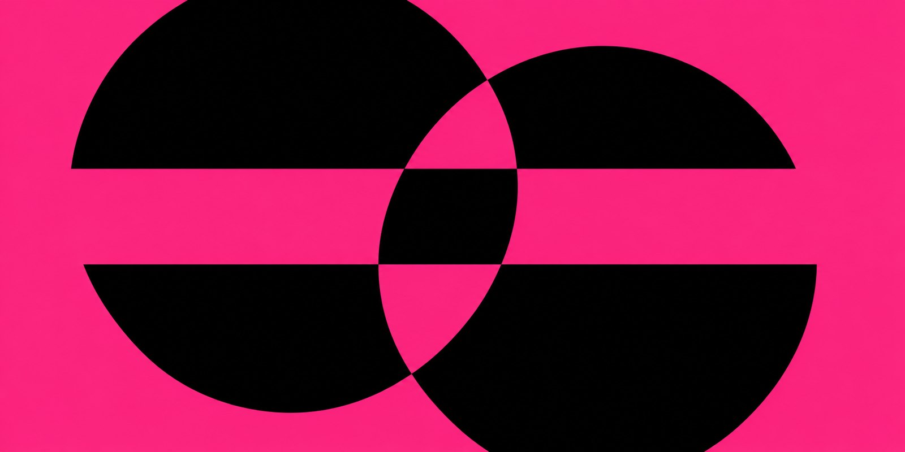
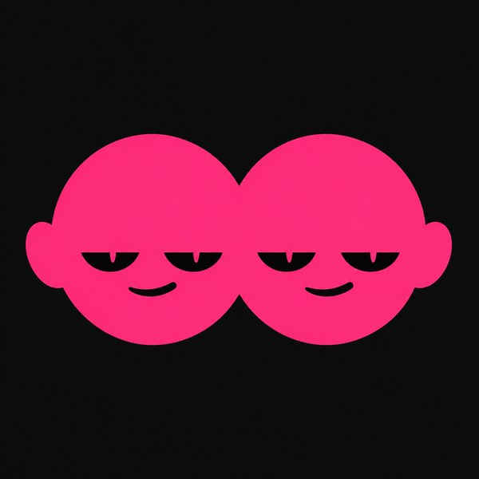

<p align="center">
  
</p>

<p align="center">
  
</p>

<h1 align="center">ddllpp</h1>

<p align="center"><b>AI agent that clones any Solana wallet's trading style.</b></p>

<p align="center">
  <a href="https://ddllpp.cc">ddllpp.cc</a> &nbsp;·&nbsp;
  <a href="https://x.com/ddllppcc">x.com/ddllppcc</a> &nbsp;·&nbsp;
  <code>$DDLLPP</code>
</p>

<br>

## Spawn your double

ddllpp runs as an MCP server inside the AI tools you already use.

**Claude Code**

```bash
claude mcp add ddllpp -- npx -y github:ddllppcc/ddllpp
```

**Codex**

```bash
codex mcp add ddllpp -- npx -y github:ddllppcc/ddllpp
```

**Cursor** — `~/.cursor/mcp.json`

```json
{
  "mcpServers": {
    "ddllpp": {
      "command": "npx",
      "args": ["-y", "github:ddllppcc/ddllpp"]
    }
  }
}
```

Then ask your agent:

```
spawn the double of <wallet>
```

| tool | does |
|---|---|
| `spawn` | trains the double of a Solana wallet and runs it from your wallet |
| `status` | shows your doubles and what they are doing |

> Doubles wake at release. Until then every call answers `soon`.

<p align="center">
  
</p>

## How a double is made

1. **Read.** The wallet's whole on-chain history, from its first signature: every entry, size, exit, and the trades it skipped.
2. **Fold.** Burners, sweeps and sibling wallets that belong to the same trader become one actor.
3. **Train.** A policy model learns why each trade happened, not only that it happened.
4. **Shadow.** The double watches live slots and writes down its move before the original makes it. It wakes only when they match.
5. **Act.** It trades from your wallet through a scoped session key: allowed programs, a cap per trade, a cap per day, an expiry. One signature revokes it. ddllpp never holds your funds or your seed.

<p align="center">
  
</p>

## Repo

```
bin/mcp.mjs           MCP server (stdio, no dependencies)
site/index.html       ddllpp.cc
site/engine/mirror.js the mirror, the ink and the double
```

Run the site locally:

```bash
cd site && python3 -m http.server 8080
```

<br>

<p align="center">
  
  
  
  
</p>

<p align="center"><sub>MIT · every trade, twice</sub></p>
